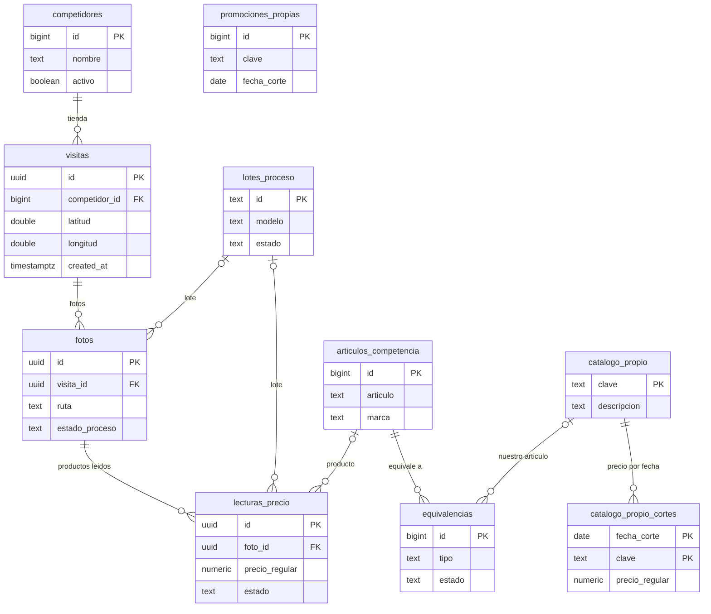

# Levantamiento de precios de la competencia: resumen del proyecto

> Documento para el equipo. Explica qué es la app, cómo funciona, cómo está construida y en qué punto está.
> No contiene datos reales, claves ni el link de la app. El link se pide al responsable del proyecto.

---

## 1. Objetivo

Centralizar el levantamiento de precios en tiendas de la competencia. Antes las fotos llegaban por WhatsApp y se capturaban a mano. Ahora:

1. El equipo de campo toma fotos de anaqueles y las sube desde una app web en el celular, junto con la ubicación.
2. Todo cae en un solo lugar (Supabase), ligado a una visita, una tienda y una ubicación.
3. En la **etapa 2**, agentes de IA (API de Claude) leerán las fotos, identificarán artículo, presentación y precio, y los compararán con **nuestro** catálogo.

Meta de largo plazo: un sistema de inteligencia de precios que responda preguntas como "en qué artículos nos cuesta más que a la competencia, en qué zonas y desde cuándo".

---

## 2. Estado actual

| Parte | Estado |
|---|---|
| Etapa 1: app de captura (visitas, ubicación, fotos) | Terminada, publicada y probada en iPhone y Android |
| Etapa 2, base: tablas de lectura, catálogo propio, equivalencias, vista de comparación | Terminada y probada con datos inventados |
| Etapa 2, agentes: lectura de fotos con la API de Claude | **No iniciada** (las fases de agentes solo empiezan cuando se piden) |
| Cambios solicitados en revisión (sección 14) | Por decidir |

El detalle fase por fase está en `docs/PROGRESO.md`.

---

## 3. Arquitectura

| Capa | Tecnología | Para qué |
|---|---|---|
| App | Next.js (App Router) + TypeScript + Tailwind | Pantallas para celular y parte de servidor |
| Publicación | Vercel | Despliega la app desde GitHub |
| Base de datos y fotos | Supabase (Postgres + Storage) | Tablas y almacenamiento de imágenes |
| Lectura de fotos (futuro) | API de Claude | Agentes que leen artículo, presentación y precio |
| Construcción | Claude Code en VS Code | Agentes que escriben el código por fases |

"App móvil" significa una **página web hecha para celular**. Se abre con un link y no se instala desde ninguna tienda.

---

## 4. Cómo funciona la app (flujo del equipo de campo)

1. La persona toma sus fotos con la **cámara normal** del celular. No se toman desde la app, por compatibilidad entre teléfonos.
2. Abre el link de la app y toca **Nueva visita**.
3. Elige la tienda de una lista que viene de la tabla `competidores`.
4. Toca **Guardar mi ubicación**. El navegador pide permiso y obtiene latitud, longitud y precisión. Nadie escribe coordenadas. Si la precisión es peor que 100 m, la app avisa. Si el permiso se niega, explica cómo activarlo en iPhone y Android y permite reintentar.
5. Toca **Guardar visita**. El botón solo se activa cuando ya hay tienda y ubicación.
6. En la pantalla de la visita sube fotos desde su galería. Antes de subir, la app:
   - convierte formatos como HEIC (iPhone) a JPEG,
   - reduce el tamaño de la foto,
   - lee la hora real de captura del archivo (si la trae).
7. Si una foto falla, las demás siguen subiendo y se muestra un mensaje en español.
8. **Volver a la lista** muestra las visitas, la más reciente primero. Se puede entrar a cualquiera y agregar más fotos.

No hay login: cualquiera que tenga el link puede usar la app.

---

## 5. Decisiones de diseño y sus consecuencias

| Decisión | Razón | Consecuencia |
|---|---|---|
| Sin login | Evitar complejidad en la primera versión | El link es la única barrera. No debe compartirse fuera del equipo |
| La visita se guarda completa de una vez (tienda + ubicación) | Sin login, la base solo permite crear, no modificar | Una tienda equivocada solo se corrige a mano en Supabase |
| Los usuarios anónimos no pueden modificar ni borrar | Que nadie con el link altere datos de otros | Borrar fotos o visitas se hace desde Supabase |
| Bucket de fotos público, con rutas aleatorias (UUID) | Es lo más simple; son fotos de anaqueles | Solo se ve con la dirección exacta. No es seguridad fuerte |
| Bucket: máximo 5 MB por archivo, solo JPEG, PNG o WebP | Controlar tamaño y tipo | La app convierte HEIC y reduce antes de subir |
| La ubicación es obligatoria solo en la app | Simplicidad | La base técnicamente aceptaría visitas sin ubicación |
| `noindex` en todas las páginas | Uso interno | Los buscadores no deben mostrar la app |
| Una llamada a la API por foto, con respuesta JSON validada | Más simple y predecible que un agente autónomo | Se evalúa más adelante si hace falta una segunda lectura |
| Comparar precio regular contra precio regular | No depende de la zona | Las promociones regionales quedan para una segunda iteración |
| Ningún dato de venta en Supabase | El permiso cubre catálogo y promociones, no volúmenes de venta | Los promedios ponderados quedan pendientes del permiso |
| Los precios propios **nunca** se envían a la API de Claude | Alcance del permiso: solo descripciones de artículos (sin precios) y fotos | Regla fija para todas las fases de agentes |

---

## 6. Modelo de datos

Son diez tablas. GitHub dibuja el diagrama automáticamente. En VS Code hace falta una extensión de Mermaid para la vista previa.



### Qué guarda cada tabla

**Captura (etapa 1)**

| Tabla | Qué guarda |
|---|---|
| `competidores` | Lista de tiendas de la competencia. `activo` decide si aparece en la app |
| `visitas` | Una ida a una tienda: tienda, ubicación, precisión y fechas |
| `fotos` | Una fila por foto, con su `ruta` en Storage, su hora de captura y su estado de procesamiento |

**Lectura de agentes (etapa 2)**

| Tabla | Qué guarda |
|---|---|
| `lotes_proceso` | Cada tanda de fotos enviada a procesar: modelo, tokens y costo estimado |
| `articulos_competencia` | Cada producto de la competencia, registrado una sola vez |
| `lecturas_precio` | Una fila por producto visto en una foto: artículo, presentación, precio, promoción, niveles de confianza (alta, media, baja), estado de revisión y lo que dijo el agente (`valores_agente`) |

**Catálogo propio (etapa 2)**

| Tabla | Qué guarda |
|---|---|
| `catalogo_propio` | Nuestros artículos. La `clave` es la llave y siempre se guarda como **texto** |
| `catalogo_propio_cortes` | Nuestro precio regular por fecha de corte |
| `promociones_propias` | Promociones propias. Se cargan, pero no entran a la comparación en esta versión |

**Puente**

| Tabla | Qué guarda |
|---|---|
| `equivalencias` | Relaciona un producto de la competencia con uno nuestro, con tipo (`mismo_articulo`, `otra_presentacion`, `sin_equivalente`) y estado (`propuesta`, `aprobada`, `rechazada`) |

### Vistas y funciones (no aparecen en la exportación de tablas)

- `catalogo_propio_actual`: nuestros artículos con la regla de "activo" (aparece en el corte más reciente, no es obsoleto, no está de baja, no es servicio y su precio es mayor que 0).
- `comparacion_precios`: compara el precio de la competencia con el nuestro. El `indice_vs_competencia_pct` es **positivo cuando nosotros somos más caros**. Solo usa equivalencias aprobadas.
- `lecturas_analisis`: vista de lecturas para análisis.
- `precio_propio_vigente(clave, fecha)`: nuestro precio regular en una fecha.
- `importar_corte`: carga el catálogo de forma "todo o nada" (una sola transacción).
- `guardar_lecturas`: guardará lo que lean los agentes.

Las columnas de precio por pieza, `unidad_base` y `contenido_base` las calcula la base de datos, no los agentes.

---

## 7. Seguridad

**Usuario anónimo (la app publicada)**
- Puede leer competidores activos, visitas y fotos.
- Puede crear visitas y fotos, solo con las columnas permitidas.
- No puede modificar ni borrar nada.
- En Storage solo puede subir a la ruta `visitas/<uuid de la visita>/<uuid>.jpg`, y solo si esa visita existe.

**Tablas, vistas y funciones de la etapa 2**
- Tienen RLS (seguridad por fila) activado y **sin permisos** para `anon` ni `authenticated`.
- Solo las usa un script local con la llave secreta.

**Llaves**
- `SUPABASE_SECRET_KEY` se salta los permisos. Solo se usa en scripts locales o en servidor. Nunca en el navegador, nunca con el prefijo `NEXT_PUBLIC`, nunca en el repositorio.
- La contraseña de la base y el token personal de Supabase son solo para uso local.

**Archivos de Storage**
- Se borran **siempre con la API de Storage**, no con SQL. Borrar filas de `storage.objects` con SQL no elimina el archivo físico y deja objetos huérfanos que siguen ocupando espacio.

---

## 8. Datos privados

- Las listas de precios y promociones propias viven en `datos-privados/`, que está en `.gitignore`. **Nunca** se suben a GitHub.
- No se copian datos reales (claves, descripciones, precios) a documentos, comentarios, mensajes de commit ni pantalla.
- Los reportes de calidad de la importación se guardan dentro de `datos-privados/`. En pantalla solo salen conteos.
- Antes de cada commit se comprueba:

```bash
git status
git check-ignore -v datos-privados/ .env.local
```

---

## 9. Estructura del repositorio

```text
Levantamiento-precio/
├── docs/
│   ├── PLAN.md               # Plan de la etapa 1 y reglas para los agentes
│   ├── PLAN_ETAPA2.md        # Plan de la etapa 2
│   ├── PROGRESO.md           # Bitácora: estado por fase y pendientes
│   └── RESUMEN_PROYECTO.md   # Este documento
├── src/
│   ├── app/                  # Pantallas (Next.js App Router)
│   └── lib/                  # Cliente de Supabase, tipos, lectura de EXIF, tipos de la etapa 2
├── supabase/                 # Migraciones SQL numeradas (se ejecutan a mano en el SQL Editor)
│   └── pruebas/              # Pruebas con datos inventados (terminan con rollback)
├── scripts/                  # Scripts locales (importación del catálogo); no forman parte de la app publicada
├── datos-privados/           # IGNORADA por git: listas de precios y reportes
├── .env.example              # Solo nombres de variables, sin valores
└── .env.local                # IGNORADA por git: valores reales
```

---

## 10. Variables de entorno

Los valores van solo en `.env.local` (local) y en el panel de Vercel (publicación). Aquí solo los nombres:

| Variable | Dónde se usa |
|---|---|
| `NEXT_PUBLIC_SUPABASE_URL` | App (navegador) y scripts |
| `NEXT_PUBLIC_SUPABASE_PUBLISHABLE_KEY` | App (navegador) y scripts |
| `SUPABASE_SECRET_KEY` | Solo scripts locales o servidor |
| `SUPABASE_PROJECT_REF` | Solo local |
| `SUPABASE_DB_PASSWORD` | Solo local |
| `SUPABASE_ACCESS_TOKEN` | Solo local (CLI) |

En Vercel solo se cargan las dos variables `NEXT_PUBLIC_` de la app. Los nombres exactos que lee el código están en `.env.example`.

---

## 11. Cómo correrlo en local

```bash
git clone <url-del-repositorio>
cd Levantamiento-precio
npm install
# crear .env.local con los valores (pedirlos al responsable del proyecto)
npm run dev          # abre http://localhost:3000
npm run lint
npm run build
```

La ubicación solo funciona en `https` o en `localhost`. Para probar el GPS en un celular se usa el link publicado en Vercel.

Importación del catálogo (script local, usa la llave secreta):

```bash
# Simulación: valida y muestra conteos, no escribe nada
npm run catalogo:importar -- datos-privados/<carpeta-del-corte>

# Importación real
npm run catalogo:importar -- datos-privados/<carpeta-del-corte> --confirmar
```

La simulación imprime a qué proyecto de Supabase apunta (solo el identificador, nunca la llave). Verifícalo antes de usar `--confirmar`.

---

## 12. Publicación

1. El código se sube a GitHub (rama `main`).
2. Vercel publica automáticamente cada push.
3. Las variables de entorno se configuran en Vercel (Project Settings → Environment Variables). Si se cambian, hay que volver a desplegar.
4. Las migraciones SQL **no** se despliegan solas: se ejecutan a mano en Supabase → SQL Editor.

---

## 13. Forma de trabajo con agentes de Claude Code

El proyecto se construyó por fases. Cada fase la hace un agente distinto, y al terminar documenta su trabajo para que otro retome.

Prompt de arranque para cada fase:

```text
Lee docs/PLAN.md, docs/PLAN_ETAPA2.md y docs/PROGRESO.md y haz la siguiente fase.
```

Reglas que cada agente sigue:

- Hacer solo su fase y actualizar `docs/PROGRESO.md` al terminar.
- No leer ni mostrar `.env.local`.
- No cambiar el lenguaje ni el framework.
- No instalar librerías sin permiso y sin explicar qué hacen.
- Las migraciones van en archivos **nuevos** en `supabase/`, sin editar los anteriores. Las ejecuta una persona, no el agente.
- Antes de cada commit, confirmar con `git status` y `git check-ignore` que `datos-privados/` y `.env.local` no están incluidos.
- No hacer push sin revisión humana.
- Las fases de agentes de IA (que llaman a la API de Claude) no empiezan sin que se pidan.

---

## 14. Pendientes y cambios solicitados en revisión

### Pendientes de decisión

- Confirmar la lista definitiva de competidores (hay una marcada "por confirmar" que no aparece en la app).
- Confirmar el umbral de ±3 % que define `en_linea` en la vista de comparación.
- Definir el **método de equivalencias**: cómo se decide que dos artículos son el mismo.
- Cuenta de la API de Claude con límite de gasto mensual.
- Muestra verificada de 20 a 30 fotos reales con su precio escrito a mano, para evaluar a los agentes.
- Permiso para cargar datos de venta (promedios ponderados).
- Cómo traducir una ubicación a una plaza.
- Verificar en qué nivel de resolución de imagen están los modelos que se usarán.
- Confirmar el plan de Supabase y su almacenamiento incluido.
- Verificar que la columna `competidor_elegido_at` de `visitas` ya fue eliminada (la migración correspondiente tiene un freno de seguridad).

### Cambios solicitados en revisión (por decidir)

| # | Cambio o pregunta | Tipo |
|---|---|---|
| 1 | Al volver a la lista, la app debe quedar "limpia" para un nuevo levantamiento | App |
| 2 | Permitir que el equipo borre fotos subidas por error | App y seguridad (requiere diseño) |
| 3 | Revisar la diferencia entre `catalogo_propio` y `catalogo_propio_actual`, y su encaje con una futura conexión automática de inventarios | Base de datos |
| 4 | Aclarar qué significa `piezas` en `articulos_competencia` | Documentación |
| 5 | Evaluar si `catalogo_propio_cortes` es necesaria | Base de datos |
| 6 | Cuestionar `calidad` y `motivo` en `fotos` | Base de datos |
| 7 | Comprimir menos las fotos para conservar legibilidad | App |
| 8 | Limpieza automática programada de archivos viejos | Operación |
| 9 | Revisar la normalización de `comparacion_precios` y sus columnas | Base de datos |
| 10 | Aclarar la diferencia entre `lecturas_precio` y `lecturas_analisis` | Base de datos |
| 11 | Cambiar la app a fondo blanco con letras negras | App |

---

## 15. Glosario

- **RLS**: seguridad por fila de Supabase. Define quién puede leer o escribir cada fila.
- **anon**: el usuario anónimo, o sea cualquiera que abre el link de la app.
- **Llave secreta (service role)**: llave de Supabase que se salta los permisos. Solo para scripts y servidor.
- **Storage bucket**: "cubeta" de Supabase donde viven los archivos de imagen.
- **Migración**: archivo SQL que cambia la estructura de la base. Se ejecuta a mano.
- **Vista**: consulta guardada que se usa como si fuera una tabla. No almacena datos propios.
- **Corte**: copia de los precios propios en una fecha determinada.
- **Equivalencia**: relación entre un producto de la competencia y uno nuestro.
- **Plaza**: zona comercial a la que pertenece una tienda. Hoy las visitas guardan latitud y longitud, no plaza.
- **EXIF**: datos que la cámara guarda dentro de la foto, como la hora de captura.
