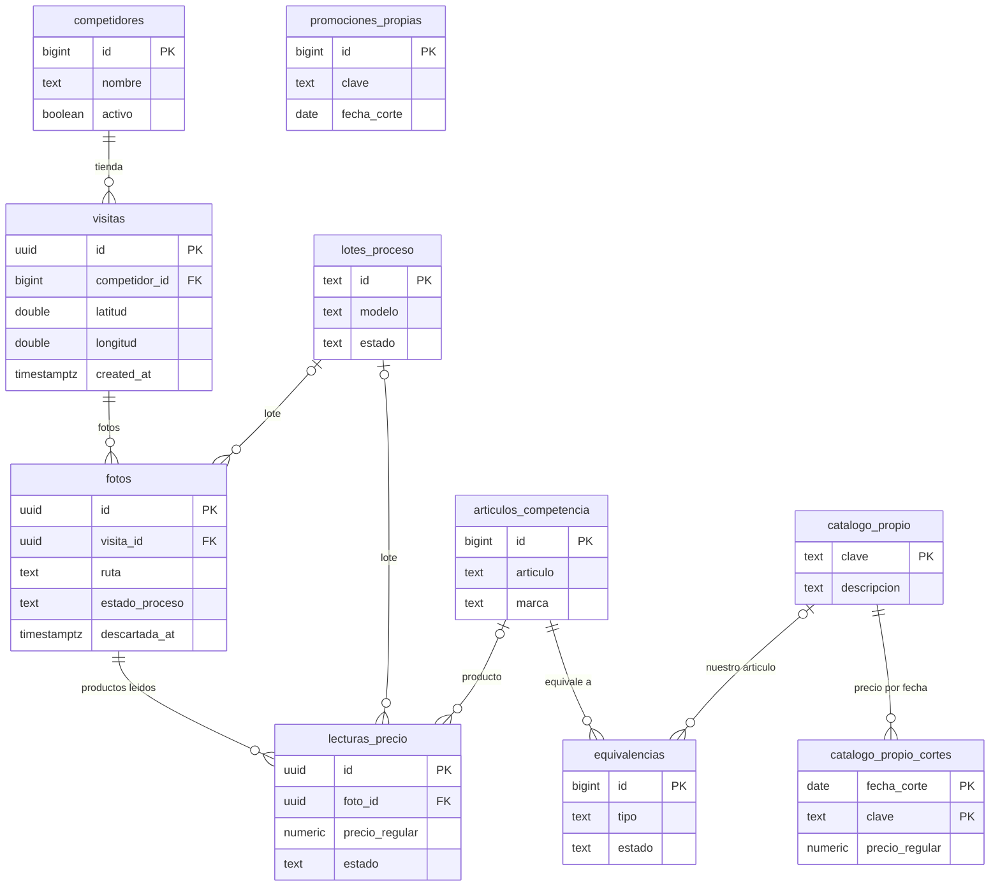

# Levantamiento de precios de la competencia

> Documento de traspaso para el equipo. Explica la idea general, cómo funciona la app, cómo está organizada la base de datos, qué se decidió, qué está pendiente y cómo modificar la app.
>
> Última actualización: 2026-11-23.
> **Fuente de verdad del avance:** `docs/PROGRESO.md`. Si algo de este documento contradice a `PROGRESO.md`, manda `PROGRESO.md`.
>
> Este documento no contiene datos reales, claves ni el link de la app. El link se pide al responsable del proyecto.

---

## 1. Propósito

Centralizar el levantamiento de precios en tiendas de la competencia. Antes, las fotos llegaban por WhatsApp y se capturaban a mano. Ahora:

1. El equipo de campo toma fotos de anaqueles y las sube desde una app web en el celular, junto con su ubicación.
2. Todo cae en un solo lugar (Supabase), ligado a una visita, una tienda y una ubicación.
3. En la **etapa 2**, agentes de IA (API de Claude) leerán las fotos, identificarán artículo, presentación y precio, y los compararán con **nuestro** catálogo.

Meta de largo plazo: un sistema de inteligencia de precios que responda "en qué artículos nos cuesta más que a la competencia, en qué zonas y desde cuándo".

---

## 2. Estado actual

| Parte | Estado |
|---|---|
| Etapa 1: app de captura (visitas, ubicación, fotos) | Terminada, publicada y probada en iPhone y Android |
| Etapa 2, base: tablas de lectura, catálogo propio, equivalencias, vista de comparación | Terminada y probada con datos inventados |
| Quitar fotos de una visita (descarte reversible, migración 007) | Código listo y confirmado en un commit. Falta verificar que la migración esté ejecutada en Supabase, que el código esté publicado y la prueba en celulares |
| Etapa 2, agentes: lectura de fotos con la API de Claude | **No iniciada.** Las fases de agentes solo empiezan cuando se piden |
| Cambios pedidos en revisión (sección 8.3) | Por decidir o por implementar |

---

## 3. Idea general de funcionamiento

### 3.1 Flujo del equipo de campo (etapa 1, ya funciona)

1. La persona toma sus fotos con la **cámara normal** del celular. No se toman desde la app, por compatibilidad entre teléfonos.
2. Abre el link de la app y toca **Nueva visita**.
3. Elige la tienda en una lista que viene de la tabla `competidores`.
4. Toca **Guardar mi ubicación**. El navegador pide permiso y obtiene latitud, longitud y precisión. Nadie escribe coordenadas. Si la precisión es peor que 100 m, la app avisa. Si se niega el permiso, explica cómo activarlo en iPhone y Android y permite reintentar.
5. Toca **Guardar visita**. El botón solo se activa cuando ya hay tienda y ubicación.
6. En la pantalla de la visita sube fotos desde su galería. Antes de subir, la app convierte formatos como HEIC (iPhone) a JPEG, reduce el tamaño y lee la hora real de captura del archivo (si la trae).
7. Si una foto falla, las demás siguen subiendo y se muestra un mensaje en español.
8. Cada foto tiene una **✕ arriba a la derecha**. Al tocarla aparece "¿Quitar esta foto?" con **Cancelar** y **Quitar**. Al confirmar, la foto se *descarta* (se oculta, no se borra el archivo). Solo se pueden quitar fotos que aún no leyó un agente.
9. **Volver a la lista** muestra las visitas, la más reciente primero. Se puede entrar a cualquiera y agregar más fotos.

No hay login: cualquiera con el link puede usar la app.

### 3.2 Flujo de la etapa 2 (aún no implementado)

1. Un agente lee cada foto pendiente y crea **una fila por producto** en `lecturas_precio`. Si el producto es nuevo, lo registra en `articulos_competencia`.
2. Cada lectura trae niveles de confianza (alta, media, baja) para artículo, presentación y precio. Si alguno es bajo, queda en revisión humana.
3. Una persona aprueba la **equivalencia** entre el producto de la competencia y uno nuestro (`equivalencias`).
4. La vista `comparacion_precios` compara el precio de la competencia con el nuestro y calcula el índice (positivo = nosotros más caros).

Reglas de la lectura con IA:
- Una llamada a la API por foto, con respuesta en JSON validada.
- Para muchas fotos se usará la Message Batches API (procesa en segundo plano y cobra la mitad).
- A la API **nunca** se envían precios propios ni datos de venta. Solo descripciones de nuestros artículos (sin precios) y las fotos de la competencia.
- El disparador del proceso no puede ser público (la app no tiene login): script local o ruta protegida con clave secreta.
- Se evaluará Sonnet 5.5 (`claude-sonnet-5-5`) frente a Haiku 5.5 (`claude-haiku-5-5`) contra una muestra de fotos verificadas a mano.

---

## 4. Arquitectura

| Capa | Tecnología | Para qué |
|---|---|---|
| App | Next.js (App Router) + TypeScript + Tailwind | Pantallas para celular y parte de servidor |
| Publicación | Vercel | Despliega la app desde GitHub en cada push |
| Base de datos y fotos | Supabase (Postgres + Storage) | Tablas y almacenamiento de imágenes |
| Lectura de fotos (futuro) | API de Claude | Agentes que leen artículo, presentación y precio |
| Construcción | Claude Code en VS Code | Agentes que escriben el código por fases |

"App móvil" significa una **página web hecha para celular**. Se abre con un link y no se instala desde ninguna tienda.

---

## 5. Base de datos

Son diez tablas más vistas y funciones. GitHub dibuja el diagrama automáticamente. En VS Code hace falta una extensión de Mermaid para la vista previa.



Cómo leer el diagrama: una flecha significa "esta tabla guarda el número de la otra". Por ejemplo, cada fila de `fotos` guarda el `id` de su visita.

### 5.1 Qué guarda cada tabla

**Captura (etapa 1)**

| Tabla | Qué guarda |
|---|---|
| `competidores` | Lista de tiendas de la competencia. `activo` decide si aparece en la app |
| `visitas` | Una ida a una tienda: tienda, ubicación, precisión y fechas |
| `fotos` | Una fila por foto: su `ruta` en Storage, hora de captura, estado de procesamiento, calidad y `descartada_at` (si se quitó) |

**Lectura de agentes (etapa 2)**

| Tabla | Qué guarda |
|---|---|
| `lotes_proceso` | Cada tanda de fotos enviada a procesar: modelo, tokens y costo estimado |
| `articulos_competencia` | Cada producto de la competencia, registrado **una sola vez** |
| `lecturas_precio` | Cada **observación**: un producto visto en una foto, con precio, promoción, confianza, estado de revisión y lo que dijo el agente (`valores_agente`) |

**Catálogo propio (etapa 2)**

| Tabla | Qué guarda |
|---|---|
| `catalogo_propio` | Nuestros artículos. La `clave` es la llave y siempre se guarda como **texto** |
| `catalogo_propio_cortes` | Nuestro precio regular por fecha de corte |
| `promociones_propias` | Promociones propias. Se cargan, pero no entran a la comparación en esta versión |

**Puente**

| Tabla | Qué guarda |
|---|---|
| `equivalencias` | Relaciona un producto de la competencia con uno nuestro. Tipos: `mismo_articulo`, `otra_presentacion`, `sin_equivalente`. Estados: `propuesta`, `aprobada`, `rechazada` |

### 5.2 Vistas y funciones

Una **vista** es una consulta guardada: no almacena datos propios, los junta de otras tablas.

| Nombre | Tipo | Para qué sirve |
|---|---|---|
| `catalogo_propio_actual` | Vista | Nuestros artículos con la regla de "activo" (aparece en el corte más reciente, no es obsoleto, no está de baja, no es servicio y su precio es mayor que 0) |
| `lecturas_analisis` | Vista | Las lecturas armadas para consultarlas y revisarlas |
| `comparacion_precios` | Vista | Compara precio de la competencia con el nuestro. Solo usa equivalencias aprobadas. `indice_vs_competencia_pct` es positivo cuando nosotros somos más caros |
| `precio_propio_vigente(clave, fecha)` | Función | Nuestro precio regular en una fecha |
| `importar_corte` | Función | Carga el catálogo de forma "todo o nada" (una sola transacción) |
| `guardar_lecturas` | Función | Guardará lo que lean los agentes |

Las columnas de precio por pieza, `unidad_base` y `contenido_base` las calcula la base de datos, no los agentes.

### 5.3 Las cuatro que más se confunden

| Nombre | Tipo | Cuándo se usa |
|---|---|---|
| `articulos_competencia` | Tabla | Catálogo de productos de la competencia, cada uno una sola vez. Lo llena el agente |
| `lecturas_precio` | Tabla | Cada observación de un producto en una foto. Lo llena el agente, y las personas corrigen |
| `lecturas_analisis` | Vista | Revisar qué leyó el agente |
| `comparacion_precios` | Vista | Análisis y tableros contra nuestros precios |

Hay duplicación entre `lecturas_precio` y `articulos_competencia` (artículo, marca, cantidad, unidad, piezas) y entre las dos vistas (columnas de foto, visita y tienda). Está pendiente de decisión (sección 8.3).

### 5.4 Significado de algunas columnas

- **`piezas`**: cuántas unidades vienen en lo que cuesta el precio de la etiqueta. `cantidad` es el contenido de **una** pieza. Ejemplo inventado: un paquete de 6 latas de 355 ml es `cantidad = 355`, `unidad = ml`, `piezas = 6`. Un producto suelto tiene `piezas = 1`.
- **`catalogo_propio_cortes`**: nuestro precio por fecha. Sirve para comparar una foto del día 10 con nuestro precio de ese día, no con el de hoy.
- **`fotos.calidad` y `motivo_calidad`**: el agente marcará si la foto es legible, borrosa, con reflejo, lejana o sin precios, y por qué. Sirve para mandarla a revisión y dar retroalimentación al equipo de campo.

---

## 6. Seguridad

**Usuario anónimo (cualquiera con el link de la app)**
- Puede leer competidores activos, visitas y fotos.
- Puede crear visitas y fotos, solo con las columnas permitidas.
- Puede **descartar** una foto que aún esté pendiente (permiso solo sobre la columna `descartada_at`, según la migración 007). No puede restaurarla.
- No puede modificar ninguna otra columna ni borrar filas.
- En Storage solo puede subir a la ruta `visitas/<uuid de la visita>/<uuid>.jpg`, y solo si esa visita existe.

**Tablas, vistas y funciones de la etapa 2**
- Tienen RLS (seguridad por fila) activado y **sin permisos** para `anon` ni `authenticated`.
- Solo las usa un script local con la llave secreta.

**Llaves**
- `SUPABASE_SECRET_KEY` se salta los permisos. Solo se usa en scripts locales o en servidor. Nunca en el navegador, nunca con el prefijo `NEXT_PUBLIC`, nunca en el repositorio.
- La contraseña de la base y el token personal de Supabase son solo para uso local.

**Archivos de Storage**
- Se borran **siempre con la API de Storage**, nunca con SQL. Borrar filas de `storage.objects` con SQL no elimina el archivo físico y deja objetos huérfanos que siguen ocupando cuota.

**Límites conocidos**
- El link es la única barrera. Si se filtra, cualquiera puede crear visitas, subir fotos y descartar fotos pendientes.
- `noindex` evita que Google muestre la app, pero no es seguridad.
- La hora de captura de una foto la manda el navegador y puede falsearse. La referencia confiable es `created_at`, que pone el servidor.

---

## 7. Decisiones tomadas

| Decisión | Razón | Consecuencia |
|---|---|---|
| Sin login | Evitar complejidad en la primera versión | El link es la única barrera. No debe compartirse fuera del equipo |
| La visita se guarda completa de una vez (tienda + ubicación) | Sin login, la base solo permite crear, no modificar | Una tienda equivocada solo se corrige a mano en Supabase |
| Quitar fotos = **descartar**, no borrar | Cualquiera puede quitar fotos, pero el error es recuperable | La foto sigue en Storage hasta la limpieza programada. Para restaurar: vaciar `descartada_at` en Supabase |
| Solo se puede descartar una foto **pendiente** (no leída por un agente) | Las lecturas dependen de la foto | Después de procesada, se corrige desde Supabase |
| El descarte se guarda al confirmar, sin "Deshacer" | Simplicidad | Un error se corrige desde Supabase |
| Bucket público, rutas con UUID | Lo más simple; son fotos de anaqueles | Solo se ve con la dirección exacta. No es seguridad fuerte |
| Bucket: máximo 5 MB por archivo, solo JPEG, PNG o WebP | Controlar tamaño y tipo | La app convierte HEIC y reduce antes de subir |
| Ubicación obligatoria solo en la app | Simplicidad | La base técnicamente aceptaría visitas sin ubicación |
| Fotos tomadas con la cámara normal | Compatibilidad entre teléfonos | La app solo sube desde la galería |
| `noindex` en todas las páginas | Uso interno | Los buscadores no muestran la app |
| Comparar precio regular contra precio regular | No depende de la zona | Las promociones regionales quedan para una segunda iteración |
| Ningún dato de venta en Supabase | El permiso cubre catálogo y promociones, no volúmenes de venta | Los promedios ponderados quedan pendientes del permiso |
| Precios propios nunca van a la API de Claude | Alcance del permiso | Regla fija para todas las fases de agentes |
| `clave` del catálogo es texto, nunca número | Se perderían ceros a la izquierda | El importador la guarda tal cual |
| Importar el catálogo con un script local, todo o nada | Seguridad y consistencia | Sin ruta pública que dispare la importación |
| Índice con signo positivo = nosotros más caros | Compatibilidad con el análisis previo | La columna se llama `indice_vs_competencia_pct` |
| Las fases de agentes solo empiezan cuando se piden | Generan costos | Cada fase la autoriza una persona |

### Valores vigentes de las fotos (pueden cambiar, ver 8.3)

- Tamaño máximo: 2200 px de lado mayor, calidad JPEG 0.85, tope 4 MB.
- La API reduce por su cuenta las imágenes que pasan de su límite. En el nivel de alta resolución es 2576 px de lado mayor y 4784 tokens visuales. Hay que verificar en qué nivel están los modelos que se usarán.

---

## 8. Pendientes

### 8.1 Decisiones que faltan

- Confirmar la lista definitiva de competidores (hay una marcada "por confirmar" que no aparece en la app).
- Confirmar el umbral de ±3 % que define `en_linea` en `comparacion_precios`.
- Definir el **método de equivalencias**: cómo se decide que dos artículos son el mismo.
- Permiso para cargar datos de venta (promedios ponderados).
- Definir cómo traducir una ubicación a una **plaza** (hoy las visitas guardan latitud y longitud).
- Definir la **política de retención**: qué se borra y cuándo. La muestra verificada de evaluación no debe borrarse.
- Confirmar el plan de Supabase y su almacenamiento incluido (las fotos nuevas pesan más).

### 8.2 Tareas y verificaciones

- [ ] Verificar que la migración 007 (descarte de fotos) esté ejecutada en Supabase y que `anon` solo pueda actualizar `descartada_at` en `fotos` y no pueda borrar.
- [ ] Publicar el código del descarte en Vercel y probarlo en iPhone y Android.
- [ ] Verificar que la columna `competidor_elegido_at` de `visitas` ya fue eliminada (su migración tiene un freno de seguridad).
- [ ] Cuenta de la API de Claude con **límite de gasto mensual** (antes de la primera fase de agentes).
- [ ] Muestra verificada: 20 a 30 fotos reales con su precio escrito a mano, para evaluar a los agentes.
- [ ] Verificar el nivel de resolución de imagen de Sonnet 5.5 y Haiku 5.5.
- [ ] Una vez que existan datos reales, borrar visitas y fotos de prueba desde Supabase (primero `fotos`, luego `visitas`; en Storage, borrar con la API o la interfaz).

### 8.3 Cambios pedidos en revisión

| # | Cambio o pregunta | Tipo | Dirección recomendada |
|---|---|---|---|
| 1 | Pantalla limpia al volver a la lista y abrir una nueva visita | App | Carga completa al volver y formulario siempre vacío. Revisar también la página restaurada por el navegador (botón "atrás") |
| 2 | Quitar fotos subidas por error | App y seguridad | **Implementado** como descarte reversible (ver sección 7). Falta ejecutar la migración y publicar |
| 3 | `catalogo_propio` vs `catalogo_propio_actual`, y futura conexión automática de inventarios | Base de datos | Conservar la vista como capa estable. Definir qué traerá la conexión y confirmar el permiso (inventarios y ventas no están autorizados) |
| 4 | Qué significa `piezas` | Documentación | Resuelto en 5.4 |
| 5 | ¿Hace falta `catalogo_propio_cortes`? | Base de datos | Es necesaria si se comparan precios en el tiempo. Con una conexión diaria, conviene guardar solo cuando cambia el precio |
| 6 | `calidad` y `motivo` en `fotos` | Base de datos | Dejar la calidad solo a nivel de foto y quitarla de `lecturas_precio`. Unificar los textos de motivo |
| 7 | Comprimir menos las fotos | App | Calidad 0.92, mantener 2200 px, tope 5 MB. Solo para fotos nuevas |
| 8 | Limpieza automática de archivos viejos | Operación | Tarea programada de servidor que borre con la API de Storage. No usar solo SQL. Definir antes la política de retención |
| 9 | Normalización y columnas de `comparacion_precios` | Base de datos | Es una vista: no hay duplicación en disco. Adelgazarla (por ejemplo, dejar `visita_id` en lugar de latitud y longitud). La duplicación real está entre `lecturas_precio` y `articulos_competencia` |
| 10 | Diferencia entre `lecturas_precio` y `lecturas_analisis` | Base de datos | Resuelto en 5.3. Decidir si `lecturas_analisis` es redundante frente a `comparacion_precios` |
| 11 | Fondo blanco y letras negras | App | Mantener el rojo en botones principales con texto blanco. Probar al sol |

Cambios de base de datos con tablas vacías (lecturas, equivalencias, artículos de la competencia) son baratos **ahora**. Después de que lleguen datos reales, exigen migrar filas.

---

## 9. Cómo modificar la app

### 9.1 Puesta en marcha

Requisito: acceso de lectura y escritura al repositorio privado en GitHub (se invita como colaborador desde Settings → Collaborators).

```bash
git clone <url-del-repositorio>
cd Levantamiento-precio
npm install
# crear .env.local con los valores (ver 9.2)
npm run dev          # abre http://localhost:3000
npm run lint
npm run build
```

La ubicación (GPS) solo funciona en `https` o en `localhost`. Para probarla en un celular se usa el link publicado en Vercel.

### 9.2 Lo que NO viene en GitHub

| Elemento | Por qué | Cómo se consigue |
|---|---|---|
| `.env.local` | Contiene claves | Se crea a mano con los valores del panel de Supabase. Para correr la app solo hacen falta `NEXT_PUBLIC_SUPABASE_URL` y `NEXT_PUBLIC_SUPABASE_PUBLISHABLE_KEY` |
| `datos-privados/` | Listas de precios propias | Se entrega por un canal seguro, solo a quien deba usarlas |
| Llave secreta, contraseña de base y token de Supabase | Se saltan los permisos | Solo para quien ejecute scripts. Nunca por correo ni chat abierto |

Nombres de las variables (los valores nunca van en GitHub):

| Variable | Dónde se usa |
|---|---|
| `NEXT_PUBLIC_SUPABASE_URL` | App (navegador) y scripts |
| `NEXT_PUBLIC_SUPABASE_PUBLISHABLE_KEY` | App (navegador) y scripts |
| `SUPABASE_SECRET_KEY` | Solo scripts locales o servidor |
| `SUPABASE_PROJECT_REF` | Solo local |
| `SUPABASE_DB_PASSWORD` | Solo local |
| `SUPABASE_ACCESS_TOKEN` | Solo local (CLI) |

En Vercel solo se cargan las dos variables `NEXT_PUBLIC_`. Los nombres exactos que lee el código están en `.env.example`.

### 9.3 Estructura del repositorio

```text
Levantamiento-precio/
├── docs/
│   ├── PLAN.md               # Plan de la etapa 1 y reglas para los agentes
│   ├── PLAN_ETAPA2.md        # Plan de la etapa 2
│   ├── PROGRESO.md           # Bitácora: estado por fase y pendientes
│   └── RESUMEN_PROYECTO.md   # Este documento
├── src/
│   ├── app/                  # Pantallas (Next.js App Router)
│   │   └── visitas/[id]/     # Pantalla de una visita: galería de fotos, quitar foto, confirmación
│   └── lib/                  # Cliente de Supabase, tipos, lectura de EXIF, tipos de la etapa 2
├── supabase/                 # Migraciones SQL numeradas (se ejecutan a mano)
│   └── pruebas/              # Pruebas con datos inventados (terminan con rollback)
├── scripts/                  # Scripts locales (importación del catálogo); no son parte de la app publicada
├── datos-privados/           # IGNORADA por git
├── AGENTS.md                 # Aviso sobre esta versión de Next.js
├── .env.example              # Solo nombres de variables
└── .env.local                # IGNORADA por git
```

**Importante sobre Next.js:** esta versión trae `cacheComponents` activado y tiene cambios respecto a lo que muchos conocen. Lee `AGENTS.md` y la guía en `node_modules/next/dist/docs/` antes de escribir código. En general, los datos que deben estar al día se cargan en el navegador o dentro de `<Suspense>`.

### 9.4 Cómo hacer un cambio solo de app

1. Crea una rama o trabaja sobre `main` según lo acordado en el equipo.
2. Haz el cambio y pruébalo con `npm run dev`.
3. Corre `npm run lint` y `npm run build`. Deben pasar sin errores.
4. Actualiza `docs/PROGRESO.md`.
5. Antes del commit, comprueba que no se cuelen archivos privados:

```bash
git status
git check-ignore -v datos-privados/ .env.local
```

6. `git add <archivos concretos>` (evita `git add .`), `git commit` y `git push`.
7. Vercel publica solo. Espera a **Ready** en la pestaña Deployments y prueba en un iPhone y un Android.

### 9.5 Cómo hacer un cambio en la base de datos

1. Escribe un archivo **nuevo** en `supabase/` con el siguiente número. **No edites migraciones anteriores.**
2. Hazlo ejecutable más de una vez (`if not exists`, `create or replace`, `drop ... if exists`).
3. Si agregas una tabla: activa RLS y **no** des permisos a `anon` ni `authenticated`, salvo que sea una tabla de la app pública y esté justificado.
4. Si agregas una columna que la app escribe: da permiso **por columna**, nunca un permiso general sobre la tabla.
5. Termina la migración con una consulta de comprobación (solo lee).
6. Escribe una prueba con datos inventados en `supabase/pruebas/` que termine con `rollback`.
7. Actualiza `src/lib/tipos.ts` (o `src/lib/etapa2/tipos.ts`).
8. **Orden de despliegue:** primero se ejecuta la migración en Supabase, después se hace push de la app. Si el cambio **quita** algo que la app usa, el orden es el inverso: primero se publica la app que ya no lo usa y solo después se ejecuta la migración.
9. Ejecuta la migración a mano en **Supabase → SQL Editor**. La terminal de VS Code no entiende SQL.

Verificaciones de seguridad útiles (en el SQL Editor):

```sql
-- Qué columnas de fotos puede modificar anon (debería ser solo descartada_at)
select column_name, privilege_type
from information_schema.column_privileges
where grantee = 'anon' and table_schema = 'public'
  and table_name = 'fotos' and privilege_type = 'UPDATE';

-- Si anon puede borrar algo (debería devolver 0 filas)
select table_name, privilege_type
from information_schema.role_table_grants
where grantee = 'anon' and table_schema = 'public' and privilege_type = 'DELETE';
```

### 9.6 Importar el catálogo propio

```bash
# Simulación: valida y muestra conteos, no escribe nada
npm run catalogo:importar -- datos-privados/<carpeta-del-corte>

# Importación real
npm run catalogo:importar -- datos-privados/<carpeta-del-corte> --confirmar
```

La simulación imprime a qué proyecto de Supabase apunta (solo el identificador, nunca la llave). Verifícalo antes de usar `--confirmar`. Los reportes de calidad se guardan dentro de `datos-privados/` y en pantalla solo salen conteos.

### 9.7 Datos privados

- Las listas de precios y promociones propias nunca se suben a GitHub.
- No se copian datos reales (claves, descripciones, precios) a documentos, comentarios, mensajes de commit ni capturas.
- A la API de Claude no se envían precios propios.

---

## 10. Trabajo con agentes de Claude Code

El proyecto se construyó por fases. Cada fase la hace un agente distinto, y al terminar documenta su trabajo para que otro retome.

Prompt de arranque para cada fase:

```text
Lee docs/PLAN.md, docs/PLAN_ETAPA2.md y docs/PROGRESO.md y haz la siguiente fase.
```

Reglas que cada agente sigue:

- Hacer solo su fase y actualizar `docs/PROGRESO.md` al terminar.
- No leer ni mostrar `.env.local`, ni abrir los reportes de `datos-privados/`.
- No cambiar el lenguaje ni el framework.
- No instalar librerías sin permiso y sin explicar qué hacen.
- Las migraciones van en archivos **nuevos**, y las ejecuta una persona, no el agente.
- Antes de cada commit, confirmar con `git status` y `git check-ignore` que `datos-privados/` y `.env.local` no están incluidos.
- No hacer push sin revisión humana.
- Las fases de agentes de IA (que llaman a la API de Claude) no empiezan sin que se pidan.

---

## 11. Glosario

- **RLS**: seguridad por fila de Supabase. Define quién puede leer o escribir cada fila.
- **anon**: el usuario anónimo, o sea cualquiera que abre el link de la app.
- **Llave secreta (service role)**: llave de Supabase que se salta los permisos. Solo para scripts y servidor.
- **Storage bucket**: "cubeta" de Supabase donde viven los archivos de imagen.
- **Migración**: archivo SQL que cambia la estructura de la base. Se ejecuta a mano.
- **Vista**: consulta guardada que se usa como si fuera una tabla. No almacena datos propios.
- **Descarte (soft delete)**: marcar una fila como quitada sin borrarla, para poder recuperarla.
- **Corte**: copia de los precios propios en una fecha determinada.
- **Equivalencia**: relación entre un producto de la competencia y uno nuestro.
- **Plaza**: zona comercial a la que pertenece una tienda.
- **EXIF**: datos que la cámara guarda dentro de la foto, como la hora de captura.
- **Lote (batch)**: grupo de fotos enviadas juntas a la API para procesarse en segundo plano.
