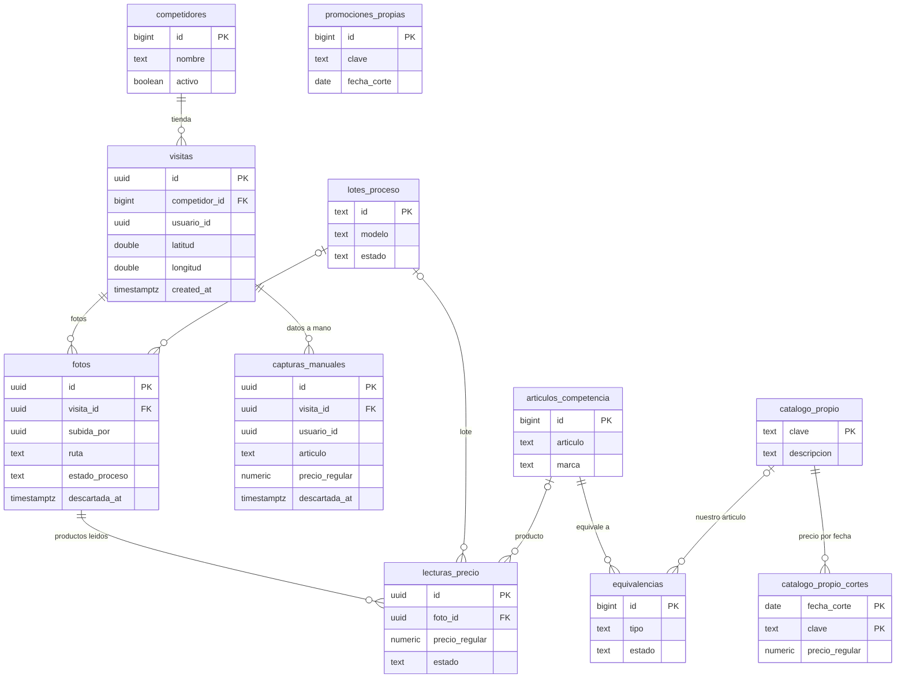

# Levantamiento de precios de la competencia

> Documento de traspaso para el equipo. Explica la idea general, cómo funciona la app, cómo está organizada la base de datos, qué se decidió, qué está pendiente y cómo modificar la app.
>
> Última actualización: 2026-11-25.
> **Fuente de verdad del avance:** `docs/PROGRESO.md`. Si algo de este documento contradice a `PROGRESO.md`, manda `PROGRESO.md`.
>
> Este documento no contiene datos reales, claves ni el link de la app. El link se pide al responsable del proyecto.

---

## 1. Propósito

Centralizar el levantamiento de precios en tiendas de la competencia. Antes, las fotos llegaban por WhatsApp y se capturaban a mano. Ahora:

1. El equipo de campo toma fotos de anaqueles y las sube desde una app web en el celular, junto con su ubicación.
2. Todo cae en un solo lugar (Supabase), ligado a una visita, una tienda y una ubicación.
3. En la **etapa 2**, agentes de IA (API de Claude) leerán las fotos, identificarán artículo, presentación y precio, y los compararán con **nuestro** catálogo.

Meta de largo plazo: un sistema de inteligencia de precios que responda "en qué artículos nos cuesta más que a la competencia, en qué zonas y desde cuándo".

---

## 2. Estado actual

| Parte | Estado |
|---|---|
| Etapa 1: app de captura (visitas, ubicación, fotos) | Terminada, publicada y probada en iPhone y Android |
| Etapa 2, base: tablas de lectura, catálogo propio, equivalencias, vista de comparación | Terminada y probada con datos inventados |
| Quitar fotos de una visita (descarte reversible, migración 007) | Terminado, ejecutado y probado en el celular (2026-11-23) |
| Login y dueño de cada visita (migraciones 008, 008b y 009) | **Terminado (2026-11-24).** Migraciones ejecutadas y probadas: login obligatorio, `anon` sin acceso y bucket privado |
| Entrar con **usuario** (`<usuario>@x24.com.mx`), solo cambio de app | Hecho (2026-11-24); falta probar en el celular y publicar |
| Captura manual de datos con sugerencias (migración 010) | Hecho (2026-11-25); reemplazada en pantalla por la captura rápida (011) |
| **Captura rápida de productos** (migración 011): 4 campos, sugerencias de artículo del catálogo propio | Hecho (2026-11-25); falta ejecutar `010` (si aún no), `010b`, `011` y su prueba, publicar y probar (orden en `PROGRESO.md`) |
| **Editar y borrar lo capturado** (migración 012; `012b` para la etapa 2, por revisar) | Hecho (2026-11-25); falta ejecutar `012` y su prueba después de `011`, publicar y probar (orden en `PROGRESO.md`) |
| Etapa 2, agentes: lectura de fotos con la API de Claude | **No iniciada.** Las fases de agentes solo empiezan cuando se piden |
| Cambios pedidos en revisión (sección 8.3) | Por decidir o por implementar |

---

## 3. Idea general de funcionamiento

### 3.1 Flujo del equipo de campo (etapa 1, ya funciona)

1. La persona toma sus fotos con la **cámara normal** del celular. No se toman desde la app, por compatibilidad entre teléfonos.
2. Abre el link de la app y **entra con su usuario y contraseña** (solo la primera vez: la sesión queda guardada en el celular hasta que toque **Cerrar sesión**). Luego toca **Nueva visita**.
3. Elige la tienda en una lista que viene de la tabla `competidores`.
4. Toca **Guardar mi ubicación**. El navegador pide permiso y obtiene latitud, longitud y precisión. Nadie escribe coordenadas. Si la precisión es peor que 100 m, la app avisa. Si se niega el permiso, explica cómo activarlo en iPhone y Android y permite reintentar.
5. Toca **Guardar visita**. El botón solo se activa cuando ya hay tienda y ubicación.
6. En la pantalla de la visita sube fotos desde su galería. Antes de subir, la app convierte formatos como HEIC (iPhone) a JPEG, reduce el tamaño y lee la hora real de captura del archivo (si la trae).
7. Si una foto falla, las demás siguen subiendo y se muestra un mensaje en español.
8. Cada foto tiene una **✕ arriba a la derecha**. Al tocarla aparece "¿Quitar esta foto?" con **Cancelar** y **Quitar**. Al confirmar, la foto se *descarta* (se oculta, no se borra el archivo). Solo se pueden quitar fotos que aún no leyó un agente.
9. **(Opcional, desde 2026-11-25; captura rápida desde `011`)** Debajo de las fotos, la sección **"Datos del levantamiento (manual)"**, pensada para capturar en segundos mientras se recorre la tienda. Solo 4 campos: **Artículo** (obligatorio; al escribir 2 letras o más sugiere hasta 6 descripciones de **nuestro** catálogo que contengan todas las palabras escritas, en cualquier orden; tocar una la llena y pasa a precio; se puede dejar lo escrito), **Precio regular** (obligatorio; teclado numérico), **Precio de promoción individual** (opcional, por pieza: "2x$42" → 21 y "2x42" en observaciones) y **Observaciones** (opcional). Enter pasa al siguiente campo; **Agregar** (o Enter en el último) pone el producto en una lista de una línea y deja el formulario listo para el siguiente. Tocar un producto de la lista lo corrige; **Quitar** lo saca (con **Deshacer**). **Guardar datos** guarda toda la lista junta (todo o nada). Lo escrito se guarda como borrador en el celular, y la app avisa si sale sin guardar. Para corregir un producto ya guardado se quita y se vuelve a escribir. La app avisa (sin impedir) si el precio es 0, si la promoción no es menor que el regular o si un precio pasa de $10,000. Estos datos todavía no los usa ningún agente.
10. **Volver a la lista** muestra **sus** visitas, la más reciente primero. Se puede entrar a cualquiera de ellas y agregar más fotos.
11. **(Desde 2026-11-25, `012`) Editar y borrar.** En los productos guardados: **Editar** (abre el mismo formulario con los datos) y **Borrar** ("¿Borrar este producto?"). En la visita: **Cambiar tienda** y **Borrar visita** ("¿Borrar esta visita?"), solo mientras ningún agente haya leído sus fotos; si ya se leyeron, la app lo explica. **Borrar = descartar**: no se borra nada, pero lo borrado ya no aparece (una visita borrada desaparece con sus fotos y productos). Solo el admin lo puede recuperar.

**Login (desde 2026-11-24; reemplaza la decisión "sin login"):** sin sesión la app no muestra nada; cada persona entra con su **usuario** (o su correo) y contraseña. Las cuentas las crea el responsable en el panel de Supabase (no hay registro público). Hay dos roles:

| Rol | Qué ve | Qué puede hacer desde la app |
|---|---|---|
| **Campo** (cualquier cuenta sin rol admin) | "Mis visitas": **solo sus** visitas **no borradas** y sus fotos | Crear visitas (quedan a su nombre), subir fotos a sus visitas y quitar fotos pendientes de sus visitas. Escribir, **editar y borrar** sus productos. **Cambiar la tienda o borrar su visita** si ningún agente leyó sus fotos. No restaura nada |
| **Admin** (`app_metadata.rol = 'admin'`) | "Todas las visitas", incluidas las de antes del login (sin dueño) y las **borradas** (marcadas "Borrada"), con el **usuario** (o el correo) de quien creó cada una, la sección "Fotos quitadas" y los productos de cualquier visita (también los borrados, con quién los creó) | **Editar, borrar y restaurar todo**: cambiar la tienda, borrar y restaurar visitas; quitar cualquier foto (también leídas) y restaurarla; editar, borrar y restaurar productos. Los productos **nuevos** los escribe solo en **sus** visitas |

Las fotos se muestran con **URLs firmadas** (links temporales de 24 h) porque el bucket es privado.

### 3.2 Flujo de la etapa 2 (aún no implementado)

1. Un agente lee cada foto pendiente y crea **una fila por producto** en `lecturas_precio`. Si el producto es nuevo, lo registra en `articulos_competencia`.
2. Cada lectura trae niveles de confianza (alta, media, baja) para artículo, presentación y precio. Si alguno es bajo, queda en revisión humana.
3. Una persona aprueba la **equivalencia** entre el producto de la competencia y uno nuestro (`equivalencias`).
4. La vista `comparacion_precios` compara el precio de la competencia con el nuestro y calcula el índice (positivo = nosotros más caros).

Reglas de la lectura con IA:
- Una llamada a la API por foto, con respuesta en JSON validada.
- Para muchas fotos se usará la Message Batches API (procesa en segundo plano y cobra la mitad).
- A la API **nunca** se envían precios propios ni datos de venta. Solo descripciones de nuestros artículos (sin precios) y las fotos de la competencia.
- El disparador del proceso no es público: script local (decisión vigente; el login de la app no cambia esto).
- Se evaluará Sonnet 5.5 (`claude-sonnet-5-5`) frente a Haiku 5.5 (`claude-haiku-5-5`) contra una muestra de fotos verificadas a mano.

---

## 4. Arquitectura

| Capa | Tecnología | Para qué |
|---|---|---|
| App | Next.js (App Router) + TypeScript + Tailwind | Pantallas para celular y parte de servidor |
| Publicación | Vercel | Despliega la app desde GitHub en cada push |
| Base de datos y fotos | Supabase (Postgres + Storage) | Tablas y almacenamiento de imágenes |
| Lectura de fotos (futuro) | API de Claude | Agentes que leen artículo, presentación y precio |
| Construcción | Claude Code en VS Code | Agentes que escriben el código por fases |

"App móvil" significa una **página web hecha para celular**. Se abre con un link y no se instala desde ninguna tienda.

---

## 5. Base de datos

Son once tablas más vistas y funciones. GitHub dibuja el diagrama automáticamente. En VS Code hace falta una extensión de Mermaid para la vista previa.



Cómo leer el diagrama: una flecha significa "esta tabla guarda el número de la otra". Por ejemplo, cada fila de `fotos` guarda el `id` de su visita.

### 5.1 Qué guarda cada tabla

**Captura (etapa 1)**

| Tabla | Qué guarda |
|---|---|
| `competidores` | Lista de tiendas de la competencia. `activo` decide si aparece en la app |
| `visitas` | Una ida a una tienda: tienda, ubicación, precisión, fechas, `usuario_id` (quién la creó; nulo en las de antes del login) y `descartada_at` (si se borró, `012`) |
| `fotos` | Una fila por foto: su `ruta` en Storage, hora de captura, estado de procesamiento, calidad, `descartada_at` (si se quitó) y `subida_por` (quién la subió) |

| `capturas_manuales` | (2026-11-25, `010` y `011`) Datos del levantamiento escritos **a mano** en la pantalla de una visita: una fila por producto. La captura rápida (`011`) llena `articulo`, `articulo_de_lista` (si se eligió de las sugerencias), `precio_regular`, `promo_precio_pieza` (promoción por pieza, opcional) y `observaciones`; además `usuario_id` (quién la escribió), `descartada_at` (si se borró) y, desde `012`, `actualizado_at`/`actualizado_por` (última edición; los pone la base). Las columnas del formulario anterior (cantidad, unidad, piezas, marca, área, tipo de promoción) siguen, **opcionales**. **Ningún agente la lee**: sirve como muestra verificada |

`usuario_id` y `subida_por` apuntan a las cuentas de Supabase Auth (`auth.users`). Los pone el servidor; la app no puede mandarlos.

**Lectura de agentes (etapa 2)**

| Tabla | Qué guarda |
|---|---|
| `lotes_proceso` | Cada tanda de fotos enviada a procesar: modelo, tokens y costo estimado |
| `articulos_competencia` | Cada producto de la competencia, registrado **una sola vez** |
| `lecturas_precio` | Cada **observación**: un producto visto en una foto, con precio, promoción, confianza, estado de revisión y lo que dijo el agente (`valores_agente`) |

**Catálogo propio (etapa 2)**

| Tabla | Qué guarda |
|---|---|
| `catalogo_propio` | Nuestros artículos. La `clave` es la llave y siempre se guarda como **texto** |
| `catalogo_propio_cortes` | Nuestro precio regular por fecha de corte |
| `promociones_propias` | Promociones propias. Se cargan, pero no entran a la comparación en esta versión |

**Puente**

| Tabla | Qué guarda |
|---|---|
| `equivalencias` | Relaciona un producto de la competencia con uno nuestro. Tipos: `mismo_articulo`, `otra_presentacion`, `sin_equivalente`. Estados: `propuesta`, `aprobada`, `rechazada` |

### 5.2 Vistas y funciones

Una **vista** es una consulta guardada: no almacena datos propios, los junta de otras tablas.

| Nombre | Tipo | Para qué sirve |
|---|---|---|
| `catalogo_propio_actual` | Vista | Nuestros artículos con la regla de "activo" (aparece en el corte más reciente, no es obsoleto, no está de baja, no es servicio y su precio es mayor que 0) |
| `lecturas_analisis` | Vista | Las lecturas armadas para consultarlas y revisarlas |
| `comparacion_precios` | Vista | Compara precio de la competencia con el nuestro. Solo usa equivalencias aprobadas. `indice_vs_competencia_pct` es positivo cuando nosotros somos más caros |
| `precio_propio_vigente(clave, fecha)` | Función | Nuestro precio regular en una fecha |
| `importar_corte` | Función | Carga el catálogo de forma "todo o nada" (una sola transacción) |
| `guardar_lecturas` | Función | Guardará lo que lean los agentes |
| `es_admin()` | Función | ¿Quien consulta es admin? Lee `app_metadata.rol` del JWT (008) |
| `admin_cambiar_competidor`, `admin_restaurar_foto`, `admin_correos_usuarios` | Funciones | Lo que el admin hace desde la app (corregir tienda, restaurar foto, ver correos). Cada una revisa `es_admin()` primero (008) |
| `privado.es_dueno_de_visita`, `privado.puede_usar_visita`, `privado.competidor_activo`, `privado.competidor_en_visita_visible`, `privado.visita_de_ruta` | Funciones auxiliares (esquema `privado`, 008b) | Las usan las reglas RLS para preguntar "¿esta visita es mía o soy admin?", "¿la tienda está activa?" o "¿de qué visita es este archivo?" sin leer otra tabla con RLS. Ver sección 6 |
| `sugerencias_captura()` | Función (010) | Listas para las sugerencias del formulario anterior. Devuelve **solo** `(tipo, valor)`: nombres de **área** del catálogo y **marcas** ya capturadas. Nunca claves, precios ni descripciones. La app ya no la usa desde `011` |
| `articulos_captura()` | Función (011) | Sugerencias de **Artículo** de la captura rápida. Devuelve **un solo valor** (un arreglo de texto) con las **descripciones** de nuestros artículos activos, sin servicios, distintas y ordenadas. Un arreglo y no una fila por artículo, porque la API corta cada respuesta en ~1,000 filas y el catálogo tiene más de 3,000. Nunca claves, precios ni ventas. Solo `authenticated` la ejecuta |
| `privado.visita_sin_fotos_leidas` | Función auxiliar (012) | ¿Ningún agente ha leído las fotos de esta visita? La usa la regla que deja al dueño cambiar la tienda o borrar la visita. Lee fotos sin RLS |
| `privado.normalizar_unidad_base`, `privado.normalizar_contenido_base` | Funciones auxiliares (010) | Envoltorios de las funciones de normalización de la etapa 2, para que `capturas_manuales` calcule `unidad_base` y `contenido_base` igual que `lecturas_precio` sin abrir esas funciones a la app |

Las columnas de precio por pieza, `unidad_base` y `contenido_base` las calcula la base de datos, no los agentes.

### 5.3 Las cuatro que más se confunden

| Nombre | Tipo | Cuándo se usa |
|---|---|---|
| `articulos_competencia` | Tabla | Catálogo de productos de la competencia, cada uno una sola vez. Lo llena el agente |
| `lecturas_precio` | Tabla | Cada observación de un producto en una foto. Lo llena el agente, y las personas corrigen |
| `lecturas_analisis` | Vista | Revisar qué leyó el agente |
| `comparacion_precios` | Vista | Análisis y tableros contra nuestros precios |

Hay duplicación entre `lecturas_precio` y `articulos_competencia` (artículo, marca, cantidad, unidad, piezas) y entre las dos vistas (columnas de foto, visita y tienda). Está pendiente de decisión (sección 8.3).

### 5.4 Significado de algunas columnas

- **`piezas`**: cuántas unidades vienen en lo que cuesta el precio de la etiqueta. `cantidad` es el contenido de **una** pieza. Ejemplo inventado: un paquete de 6 latas de 355 ml es `cantidad = 355`, `unidad = ml`, `piezas = 6`. Un producto suelto tiene `piezas = 1`.
- **`catalogo_propio_cortes`**: nuestro precio por fecha. Sirve para comparar una foto del día 10 con nuestro precio de ese día, no con el de hoy.
- **`fotos.calidad` y `motivo_calidad`**: el agente marcará si la foto es legible, borrosa, con reflejo, lejana o sin precios, y por qué. Sirve para mandarla a revisión y dar retroalimentación al equipo de campo.

---

## 6. Seguridad

**Cuentas y roles (desde 2026-11-24, migraciones 008 y 009)**
- Se entra con **usuario o correo, y contraseña** (Supabase Auth). No hay registro público: las cuentas las crea el responsable en el panel.
- **Convención de usuarios:** cada cuenta del personal se crea con el correo `<usuario>@x24.com.mx`. El usuario va en minúsculas, de 3 a 30 caracteres, solo `a-z`, `0-9`, `.`, `_` y `-` (ej. `juan.perez`). En la app se escribe solo `juan.perez`; si lo escrito lleva `@`, se usa como correo tal cual (así entran el admin y las cuentas de antes). El dominio está en un solo lugar: `DOMINIO_INTERNO` en `src/lib/usuarios.ts`. En pantalla se muestra el usuario si el correo es del dominio interno; si no, el correo completo.
- Si falla el acceso, el mensaje es genérico ("Usuario o contraseña incorrectos"). El celular recuerda solo el último usuario escrito (nunca la contraseña), y la pantalla está hecha para que el gestor de contraseñas del teléfono la guarde.
- ⚠️ **No borrar cuentas que ya tienen visitas:** sus visitas quedan sin dueño (`on delete set null`) y se pierde quién las hizo. Para quitar el acceso, bloquear la cuenta. Cambiar la contraseña **no** cierra las sesiones ya abiertas.
- **Admin** = cuenta con `app_metadata.rol = 'admin'`. Solo el dueño lo puede poner (con SQL). **Nunca** se usa `user_metadata` para permisos, porque cada persona lo puede editar.
- El rol viaja en el JWT (el "pase" que dura 1 hora y se renueva solo): si se cambia el rol de alguien, se nota cuando vuelve a entrar o, como máximo, en 1 hora.

**Personal de campo (rol `authenticated`, sin admin)**
- Ve **solo sus visitas** y las fotos de esas visitas. Lee los competidores activos (y los de sus visitas).
- Crea visitas (quedan a su nombre solo) y sube fotos **solo a sus visitas**, en la ruta `visitas/<uuid de su visita>/<uuid>.jpg`.
- Puede **quitar** (descartar) fotos **pendientes** de sus visitas. No puede restaurarlas.
- No modifica visitas ni ninguna otra columna. No borra nada.

**Admin**
- Ve **todas** las visitas y fotos, incluidas las de antes del login (sin dueño), y el usuario (o correo) de quien creó cada una.
- Quita fotos pendientes de cualquier visita. Corrige la tienda y restaura fotos **solo con funciones** que revisan `es_admin()`; no tiene permiso general para modificar.

**Captura manual (010)**
- Cada persona ve, escribe y quita datos manuales **solo en sus visitas** (quitar: solo sus propias filas, sin restaurar, sin borrar ni cambiar otras columnas). El admin ve los de todas, pero escribe solo en las suyas.
- `usuario_id` lo pone el servidor; la app no tiene permiso de mandarlo. Todas las reglas de valores (unidades, decimales, promociones) están **en la base** (CHECK), no solo en la app.
- La app **no** tiene acceso a `catalogo_propio` ni a ninguna tabla de la etapa 2: los nombres de área los entrega `sugerencias_captura()` y las descripciones de artículos `articulos_captura()` (011); ninguna devuelve claves, precios ni ventas. Las marcas sugeridas son compartidas entre personas (solo el nombre).
- `011` no cambia las reglas de acceso; solo agrega dos columnas que `authenticated` puede mandar al crear (`articulo_de_lista`, `promo_precio_pieza`) y CHECK en la base (artículo no vacío y hasta 200; precios ≥ 0 con 2 decimales; observaciones hasta 500).
- Después de `010`, las comprobaciones finales viejas de `008b` y `009` marcan `false` en las filas que cuentan funciones o tablas abiertas; después de `011`, también la fila 14 de la de `010`. Es normal (ver `PROGRESO.md`, "Avisos permanentes").

**Editar y borrar (012)**
- **Borrar = descartar** (`descartada_at`, hora del servidor). Nadie hace `DELETE` desde la app. Solo el admin restaura.
- Permisos **por columna**: en visitas solo la tienda y `descartada_at`; en productos solo los campos del formulario, `articulo_de_lista` y `descartada_at`. Nunca dueño, visita, fechas ni `actualizado_*` (los pone un *trigger*).
- El dueño solo toca sus filas **no borradas** (en visitas, además sin fotos leídas); si no se puede, el cambio afecta 0 filas y la app avisa. La tienda nueva debe estar activa.
- Lo borrado no se le muestra al personal de campo (tampoco las fotos ni los productos de una visita borrada). Las reglas comparan con `now()` para que la propia operación de borrar sí funcione (detalle en `PLAN.md` 4.3).
- La etapa 2 no debe usar fotos quitadas ni de visitas borradas: `012b` (por revisar) ajusta sus vistas y `guardar_lecturas`.
- Después de `012`, algunas comprobaciones y pruebas viejas marcan `false`. Es normal (ver `PROGRESO.md`).

**Sin sesión (`anon`)**
- **Nada** (desde 009, ejecutada el 2026-11-24). No lee, no crea, no ve fotos. Los links públicos viejos de fotos ya no abren.

**Fotos (Storage)**
- Bucket `fotos` **privado** (desde 009). La app pide con la sesión de la persona una **URL firmada** por foto (`src/lib/urlsFirmadas.ts`); dura **24 horas** y la app la renueva sola antes de que caduque. Solo se puede pedir para fotos de visitas que la persona puede ver. Mientras no caduca, un link copiado abre la foto para cualquiera.
- Nadie puede reemplazar ni borrar archivos desde la app.

**Esquema `privado` y funciones auxiliares (008b)**
- Problema que resuelven: en 008 la regla para crear una visita leía `competidores`, cuya regla leía `visitas`, y Postgres cortaba con "infinite recursion" al guardar una visita.
- Solución: las reglas ya no leen otras tablas directamente; llaman a funciones pequeñas del esquema `privado` (ver 5.2). Cuatro son `security definer` (leen `visitas` o `competidores` sin aplicar sus reglas, por eso no hay ciclo) y solo responden sí/no sobre la persona que consulta (su id y su rol salen del JWT); nunca devuelven datos de filas. La quinta, `visita_de_ruta`, no lee tablas: solo saca el id de la visita de la ruta `visitas/<uuid>/…`.
- El esquema `privado` no lo publica la API de Supabase: la app no puede llamar esas funciones. Solo `authenticated` las puede ejecutar (desde las reglas); `anon` no.

**Tablas, vistas y funciones de la etapa 2**
- Tienen RLS (seguridad por fila) activado y **sin permisos** para `anon` ni `authenticated`, **también para el admin** dentro de la app. (`capturas_manuales` no es de la etapa 2: es parte de la app.)
- Solo las usa un script local con la llave secreta.

**Llaves**
- `SUPABASE_SECRET_KEY` se salta los permisos. Solo se usa en scripts locales o en servidor. Nunca en el navegador, nunca con el prefijo `NEXT_PUBLIC`, nunca en el repositorio. La app usa solo la llave pública.
- La contraseña de la base y el token personal de Supabase son solo para uso local.

**Archivos de Storage**
- Se borran **siempre con la API de Storage**, nunca con SQL. Borrar filas de `storage.objects` con SQL no elimina el archivo físico y deja objetos huérfanos que siguen ocupando cuota.

**Límites conocidos**
- La sesión se guarda en el navegador del celular. En un celular compartido hay que tocar **Cerrar sesión**.
- Con la configuración por defecto de Supabase la sesión no caduca (el pase de 1 hora se renueva solo). Safari en iPhone borra los datos de un sitio que no se abre en 7 días: quien no use la app en una semana tendrá que volver a entrar.
- Un link de foto copiado sirve hasta 24 h.
- Borrar una cuenta deja sus visitas sin dueño (solo las ve el admin). Por eso **no se borran** cuentas con visitas.
- ⚠️ **No volver a ejecutar `008_autenticacion.sql` después de `008b`:** regresa las reglas con el ciclo y guardar una visita vuelve a fallar. Si pasa, ejecutar `008b` otra vez.
- **No** se deben volver a ejecutar `001_esquema.sql` ni `007_descartar_fotos.sql`: vuelven a abrir permisos a `anon`.
- `supabase/reversa_009.sql` deshace 009 (devuelve `anon` y el bucket público). **Solo para emergencias**; no está ejecutado.
- `noindex` evita que Google muestre la app, pero no es seguridad.
- La hora de captura de una foto la manda el navegador y puede falsearse. La referencia confiable es `created_at`, que pone el servidor.

---

## 7. Decisiones tomadas

| Decisión | Razón | Consecuencia |
|---|---|---|
| ~~Sin login~~ → **Login con correo y contraseña** (2026-11-24) | Que cada quien vea solo lo suyo y saber quién creó cada visita | Las cuentas las crea el responsable. El link solo ya no basta (después de 009) |
| Rol admin en `app_metadata`, nunca en `user_metadata` | `user_metadata` lo puede editar cada persona | Para hacer admin a alguien hace falta una línea de SQL |
| Las visitas de antes del login quedan sin dueño | No se sabe quién las hizo | Solo las ve el admin |
| El admin edita con **funciones** (corregir tienda, restaurar foto), no con permiso general | Las reglas filtran filas, no columnas | Cada edición nueva del admin es una función nueva |
| Se muestra el **correo** de quien creó la visita (solo al admin) | Sale solo de la cuenta; no hay que capturar nada | La app lo pide con `admin_correos_usuarios` |
| Entrar con **usuario**: cuenta = `<usuario>@x24.com.mx` (2026-11-24) | Más fácil de escribir en el celular; Supabase solo entra con correo | Las cuentas se crean con ese correo. El dominio vive en `src/lib/usuarios.ts`. En pantalla se muestra el usuario |
| Dos migraciones: 008 (agrega) y 009 (cierra a `anon`) | Que la app publicada no se rompa durante el cambio | Ejecutadas en ese orden (con 008b entre ellas) el 2026-11-24 |
| Reglas RLS que no leen otras tablas: usan funciones del esquema `privado` (008b) | Evitar el ciclo de reglas ("infinite recursion") | No volver a ejecutar 008 después de 008b |
| Sesión solo en el navegador, sin librerías nuevas | Todos los datos ya se leían desde el navegador | La seguridad la dan las reglas de la base, no las páginas |
| La visita se guarda completa de una vez (tienda + ubicación) | Nadie puede modificar visitas desde la app | El admin corrige la tienda desde la app; lo demás, en Supabase |
| Quitar fotos = **descartar**, no borrar | Cualquiera puede quitar fotos, pero el error es recuperable | La foto sigue en Storage hasta la limpieza programada. Para restaurar: vaciar `descartada_at` en Supabase |
| Solo se puede descartar una foto **pendiente** (no leída por un agente) | Las lecturas dependen de la foto | Después de procesada, se corrige desde Supabase |
| El descarte se guarda al confirmar, sin "Deshacer" | Simplicidad | Un error se corrige desde Supabase |
| ~~Bucket público~~ → **bucket privado con URLs firmadas de 24 h** (009) | Que solo vea las fotos quien tiene sesión | Un link copiado sirve hasta 24 h. La app renueva los links sola |
| Bucket: máximo 5 MB por archivo, solo JPEG, PNG o WebP | Controlar tamaño y tipo | La app convierte HEIC y reduce antes de subir |
| Ubicación obligatoria solo en la app | Simplicidad | La base técnicamente aceptaría visitas sin ubicación |
| Fotos tomadas con la cámara normal | Compatibilidad entre teléfonos | La app solo sube desde la galería |
| `noindex` en todas las páginas | Uso interno | Los buscadores no muestran la app |
| Comparar precio regular contra precio regular | No depende de la zona | Las promociones regionales quedan para una segunda iteración |
| Ningún dato de venta en Supabase | El permiso cubre catálogo y promociones, no volúmenes de venta | Los promedios ponderados quedan pendientes del permiso |
| Precios propios nunca van a la API de Claude | Alcance del permiso | Regla fija para todas las fases de agentes |
| `clave` del catálogo es texto, nunca número | Se perderían ceros a la izquierda | El importador la guarda tal cual |
| Importar el catálogo con un script local, todo o nada | Seguridad y consistencia | Sin ruta pública que dispare la importación |
| Índice con signo positivo = nosotros más caros | Compatibilidad con el análisis previo | La columna se llama `indice_vs_competencia_pct` |
| Las fases de agentes solo empiezan cuando se piden | Generan costos | Cada fase la autoriza una persona |
| Captura manual en la app (`capturas_manuales`, 010), opcional y por visita (2026-11-25) | Tener datos verificados para comparar contra los agentes | Los agentes **no** la leen; corregir = quitar y volver a escribir; guardar es todo o nada |
| Sugerencias de área por una función que solo da nombres | La app no debe tener acceso al catálogo ni a la etapa 2 | Nunca se exponen claves, precios ni descripciones |
| Borrar = descartar; campo edita/borra solo lo suyo; admin todo y restaura (012, 2026-11-25) | Corregir errores sin perder datos ni historial | Reemplaza "el personal de campo no modifica visitas" **solo para cambiar la tienda**, y solo si ningún agente leyó sus fotos |
| Captura rápida de 4 campos (011, 2026-11-25) | En la tienda, capturar un producto debe tomar segundos | Contenido, unidad, marca, área y tipo de promoción ya no se piden; la promoción es **por pieza** y el detalle ("2x42") va en observaciones |
| Sugerencias de artículo = descripciones de nuestro catálogo, en **un** arreglo | La API corta en ~1,000 filas y el catálogo tiene más de 3,000 | La lista se carga una vez y se filtra en el celular; si no carga, se escribe a mano |
| Decimales de más se **rechazan** en la base (no se redondean) | Que un dato mal escrito no se guarde cambiado | La app avisa antes con un mensaje en español |

### Valores vigentes de las fotos (pueden cambiar, ver 8.3)

- Tamaño máximo: 2200 px de lado mayor, calidad JPEG 0.85, tope 4 MB.
- La API reduce por su cuenta las imágenes que pasan de su límite. En el nivel de alta resolución es 2576 px de lado mayor y 4784 tokens visuales. Hay que verificar en qué nivel están los modelos que se usarán.

---

## 8. Pendientes

### 8.1 Decisiones que faltan

- Confirmar la lista definitiva de competidores (hay una marcada "por confirmar" que no aparece en la app).
- Confirmar el umbral de ±3 % que define `en_linea` en `comparacion_precios`.
- Definir el **método de equivalencias**: cómo se decide que dos artículos son el mismo.
- Permiso para cargar datos de venta (promedios ponderados).
- Definir cómo traducir una ubicación a una **plaza** (hoy las visitas guardan latitud y longitud).
- Definir la **política de retención**: qué se borra y cuándo. La muestra verificada de evaluación no debe borrarse.
- Confirmar el plan de Supabase y su almacenamiento incluido (las fotos nuevas pesan más).

### 8.2 Tareas y verificaciones

- [ ] (Opcional) Registrar quién y cuándo corrigió la tienda de una visita (hoy no queda rastro).
- [ ] Verificar que la columna `competidor_elegido_at` de `visitas` ya fue eliminada (su migración tiene un freno de seguridad).
- [ ] Cuenta de la API de Claude con **límite de gasto mensual** (antes de la primera fase de agentes).
- [ ] Muestra verificada: 20 a 30 fotos reales con su precio escrito a mano, para evaluar a los agentes. **Propuesta (2026-11-25):** usar la captura manual de la app (`capturas_manuales`); ver `PLAN_ETAPA2.md` 9.5. Regla: los agentes **no** ven esas filas al leer.
- [ ] Captura rápida y editar/borrar: ejecutar `010` (si aún no), `010b`, `011`, prueba `011`, `012`, prueba `012` (y, si se aprueba, `012b`), publicar y probar con dos cuentas de campo y el admin (orden en `PROGRESO.md`, "Editar y borrar lo capturado").
- [ ] Verificar el nivel de resolución de imagen de Sonnet 5.5 y Haiku 5.5.
- [ ] Una vez que existan datos reales, borrar visitas y fotos de prueba desde Supabase (primero `fotos`, luego `visitas`; en Storage, borrar con la API o la interfaz).

### 8.3 Cambios pedidos en revisión

| # | Cambio o pregunta | Tipo | Dirección recomendada |
|---|---|---|---|
| 1 | Pantalla limpia al volver a la lista y abrir una nueva visita | App | Carga completa al volver y formulario siempre vacío. Revisar también la página restaurada por el navegador (botón "atrás") |
| 2 | Quitar fotos subidas por error | App y seguridad | **Implementado** como descarte reversible (ver sección 7). Ejecutado y publicado. Con el login, el personal solo quita fotos de sus visitas y el admin puede restaurarlas |
| 3 | `catalogo_propio` vs `catalogo_propio_actual`, y futura conexión automática de inventarios | Base de datos | Conservar la vista como capa estable. Definir qué traerá la conexión y confirmar el permiso (inventarios y ventas no están autorizados) |
| 4 | Qué significa `piezas` | Documentación | Resuelto en 5.4 |
| 5 | ¿Hace falta `catalogo_propio_cortes`? | Base de datos | Es necesaria si se comparan precios en el tiempo. Con una conexión diaria, conviene guardar solo cuando cambia el precio |
| 6 | `calidad` y `motivo` en `fotos` | Base de datos | Dejar la calidad solo a nivel de foto y quitarla de `lecturas_precio`. Unificar los textos de motivo |
| 7 | Comprimir menos las fotos | App | Calidad 0.92, mantener 2200 px, tope 5 MB. Solo para fotos nuevas |
| 8 | Limpieza automática de archivos viejos | Operación | Tarea programada de servidor que borre con la API de Storage. No usar solo SQL. Definir antes la política de retención |
| 9 | Normalización y columnas de `comparacion_precios` | Base de datos | Es una vista: no hay duplicación en disco. Adelgazarla (por ejemplo, dejar `visita_id` en lugar de latitud y longitud). La duplicación real está entre `lecturas_precio` y `articulos_competencia` |
| 10 | Diferencia entre `lecturas_precio` y `lecturas_analisis` | Base de datos | Resuelto en 5.3. Decidir si `lecturas_analisis` es redundante frente a `comparacion_precios` |
| 11 | Fondo blanco y letras negras | App | Mantener el rojo en botones principales con texto blanco. Probar al sol |

Cambios de base de datos con tablas vacías (lecturas, equivalencias, artículos de la competencia) son baratos **ahora**. Después de que lleguen datos reales, exigen migrar filas.

---

## 9. Cómo modificar la app

### 9.1 Puesta en marcha

Requisito: acceso de lectura y escritura al repositorio privado en GitHub (se invita como colaborador desde Settings → Collaborators).

```bash
git clone <url-del-repositorio>
cd Levantamiento-precio
npm install
# crear .env.local con los valores (ver 9.2)
npm run dev          # abre http://localhost:3000
npm run lint
npm run build
```

La ubicación (GPS) solo funciona en `https` o en `localhost`. Para probarla en un celular se usa el link publicado en Vercel.

### 9.2 Lo que NO viene en GitHub

| Elemento | Por qué | Cómo se consigue |
|---|---|---|
| `.env.local` | Contiene claves | Se crea a mano con los valores del panel de Supabase. Para correr la app solo hacen falta `NEXT_PUBLIC_SUPABASE_URL` y `NEXT_PUBLIC_SUPABASE_PUBLISHABLE_KEY` |
| `datos-privados/` | Listas de precios propias | Se entrega por un canal seguro, solo a quien deba usarlas |
| Llave secreta, contraseña de base y token de Supabase | Se saltan los permisos | Solo para quien ejecute scripts. Nunca por correo ni chat abierto |

Nombres de las variables (los valores nunca van en GitHub):

| Variable | Dónde se usa |
|---|---|
| `NEXT_PUBLIC_SUPABASE_URL` | App (navegador) y scripts |
| `NEXT_PUBLIC_SUPABASE_PUBLISHABLE_KEY` | App (navegador) y scripts |
| `SUPABASE_SECRET_KEY` | Solo scripts locales o servidor |
| `SUPABASE_PROJECT_REF` | Solo local |
| `SUPABASE_DB_PASSWORD` | Solo local |
| `SUPABASE_ACCESS_TOKEN` | Solo local (CLI) |

En Vercel solo se cargan las dos variables `NEXT_PUBLIC_`. Los nombres exactos que lee el código están en `.env.example`.

### 9.3 Estructura del repositorio

```text
Levantamiento-precio/
├── docs/
│   ├── PLAN.md               # Plan de la etapa 1 y reglas para los agentes
│   ├── PLAN_ETAPA2.md        # Plan de la etapa 2
│   ├── PROGRESO.md           # Bitácora: estado por fase y pendientes
│   └── RESUMEN_PROYECTO.md   # Este documento
├── src/
│   ├── app/                  # Pantallas (Next.js App Router)
│   │   └── visitas/[id]/     # Pantalla de una visita: galería de fotos, quitar foto, captura manual
│   ├── components/           # PuertaSesion (pide entrar), PantallaEntrar, mensajes de error, campo con sugerencias
│   └── lib/                  # Cliente de Supabase, sesión, URLs firmadas, tipos, lectura de EXIF, captura manual, tipos de la etapa 2
├── supabase/                 # Migraciones SQL numeradas (se ejecutan a mano)
│   └── pruebas/              # Pruebas con datos inventados (terminan con rollback)
├── scripts/                  # Scripts locales (importación del catálogo); no son parte de la app publicada
├── datos-privados/           # IGNORADA por git
├── AGENTS.md                 # Aviso sobre esta versión de Next.js
├── .env.example              # Solo nombres de variables
└── .env.local                # IGNORADA por git
```

**Importante sobre Next.js:** esta versión trae `cacheComponents` activado y tiene cambios respecto a lo que muchos conocen. Lee `AGENTS.md` y la guía en `node_modules/next/dist/docs/` antes de escribir código. En general, los datos que deben estar al día se cargan en el navegador o dentro de `<Suspense>`.

### 9.4 Cómo hacer un cambio solo de app

1. Crea una rama o trabaja sobre `main` según lo acordado en el equipo.
2. Haz el cambio y pruébalo con `npm run dev`.
3. Corre `npm run lint` y `npm run build`. Deben pasar sin errores.
4. Actualiza `docs/PROGRESO.md`.
5. Antes del commit, comprueba que no se cuelen archivos privados:

```bash
git status
git check-ignore -v datos-privados/ .env.local
```

6. `git add <archivos concretos>` (evita `git add .`), `git commit` y `git push`.
7. Vercel publica solo. Espera a **Ready** en la pestaña Deployments y prueba en un iPhone y un Android.

### 9.5 Cómo hacer un cambio en la base de datos

1. Escribe un archivo **nuevo** en `supabase/` con el siguiente número. **No edites migraciones anteriores.**
2. Hazlo ejecutable más de una vez (`if not exists`, `create or replace`, `drop ... if exists`).
3. Si agregas una tabla: activa RLS y **no** des permisos a `anon` ni `authenticated`, salvo que sea una tabla de la app pública y esté justificado.
4. Si agregas una columna que la app escribe: da permiso **por columna**, nunca un permiso general sobre la tabla.
5. Termina la migración con una consulta de comprobación (solo lee).
6. Escribe una prueba con datos inventados en `supabase/pruebas/` que termine con `rollback`.
7. Actualiza `src/lib/tipos.ts` (o `src/lib/etapa2/tipos.ts`).
8. **Orden de despliegue:** primero se ejecuta la migración en Supabase, después se hace push de la app. Si el cambio **quita** algo que la app usa, el orden es el inverso: primero se publica la app que ya no lo usa y solo después se ejecuta la migración.
9. Ejecuta la migración a mano en **Supabase → SQL Editor**. La terminal de VS Code no entiende SQL.

Verificaciones de seguridad útiles (en el SQL Editor):

```sql
-- Qué columnas de fotos puede modificar una persona con sesión (debería ser solo descartada_at)
select column_name, privilege_type
from information_schema.column_privileges
where grantee = 'authenticated' and table_schema = 'public'
  and table_name = 'fotos' and privilege_type = 'UPDATE';

-- Qué permisos tiene anon en las tablas de la app (después de 009: 0 filas)
select table_name, privilege_type
from information_schema.role_table_grants
where grantee = 'anon' and table_schema = 'public'
  and table_name in ('competidores', 'visitas', 'fotos');

-- Quién es admin
select email, raw_app_meta_data ->> 'rol' as rol from auth.users;
```

### 9.6 Importar el catálogo propio

```bash
# Simulación: valida y muestra conteos, no escribe nada
npm run catalogo:importar -- datos-privados/<carpeta-del-corte>

# Importación real
npm run catalogo:importar -- datos-privados/<carpeta-del-corte> --confirmar
```

La simulación imprime a qué proyecto de Supabase apunta (solo el identificador, nunca la llave). Verifícalo antes de usar `--confirmar`. Los reportes de calidad se guardan dentro de `datos-privados/` y en pantalla solo salen conteos.

### 9.7 Datos privados

- Las listas de precios y promociones propias nunca se suben a GitHub.
- No se copian datos reales (claves, descripciones, precios) a documentos, comentarios, mensajes de commit ni capturas.
- A la API de Claude no se envían precios propios.

---

## 10. Trabajo con agentes de Claude Code

El proyecto se construyó por fases. Cada fase la hace un agente distinto, y al terminar documenta su trabajo para que otro retome.

Prompt de arranque para cada fase:

```text
Lee docs/PLAN.md, docs/PLAN_ETAPA2.md y docs/PROGRESO.md y haz la siguiente fase.
```

Reglas que cada agente sigue:

- Hacer solo su fase y actualizar `docs/PROGRESO.md` al terminar.
- No leer ni mostrar `.env.local`, ni abrir los reportes de `datos-privados/`.
- No cambiar el lenguaje ni el framework.
- No instalar librerías sin permiso y sin explicar qué hacen.
- Las migraciones van en archivos **nuevos**, y las ejecuta una persona, no el agente.
- Antes de cada commit, confirmar con `git status` y `git check-ignore` que `datos-privados/` y `.env.local` no están incluidos.
- No hacer push sin revisión humana.
- Las fases de agentes de IA (que llaman a la API de Claude) no empiezan sin que se pidan.

---

## 11. Glosario

- **RLS**: seguridad por fila de Supabase. Define quién puede leer o escribir cada fila.
- **anon**: el usuario anónimo, o sea cualquiera que abre el link de la app **sin** haber entrado. Después de 009 no puede nada.
- **authenticated**: una persona que entró con su correo y contraseña.
- **Admin**: cuenta con `app_metadata.rol = 'admin'`. Ve todo y hace algunas correcciones desde la app.
- **Campo**: cualquier cuenta sin rol admin. Ve y usa solo sus visitas.
- **Esquema `privado`**: parte de la base que la API de Supabase no publica. Guarda las funciones auxiliares de las reglas (008b).
- **JWT**: el "pase" firmado que la app manda en cada consulta. Dice quién es la persona y trae su rol. Dura 1 hora y se renueva solo.
- **URL firmada**: link temporal a una foto de un bucket privado. Aquí dura 24 horas.
- **security definer**: función de la base que corre con permisos de quien la creó. Por eso cada una revisa primero que quien la llama sea admin.
- **Llave secreta (service role)**: llave de Supabase que se salta los permisos. Solo para scripts y servidor.
- **Storage bucket**: "cubeta" de Supabase donde viven los archivos de imagen.
- **Migración**: archivo SQL que cambia la estructura de la base. Se ejecuta a mano.
- **Vista**: consulta guardada que se usa como si fuera una tabla. No almacena datos propios.
- **Descarte (soft delete)**: marcar una fila como quitada sin borrarla, para poder recuperarla.
- **Corte**: copia de los precios propios en una fecha determinada.
- **Equivalencia**: relación entre un producto de la competencia y uno nuestro.
- **Plaza**: zona comercial a la que pertenece una tienda.
- **EXIF**: datos que la cámara guarda dentro de la foto, como la hora de captura.
- **Lote (batch)**: grupo de fotos enviadas juntas a la API para procesarse en segundo plano.
